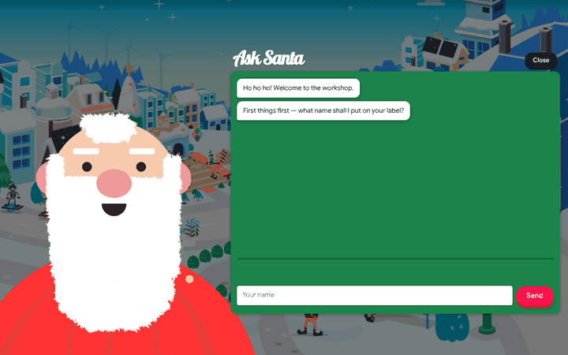
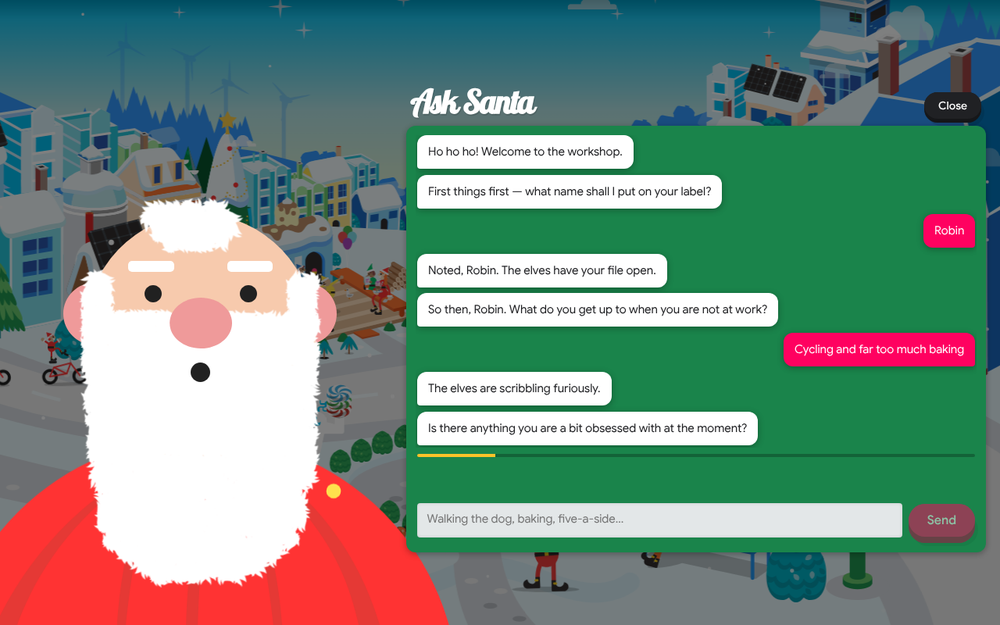
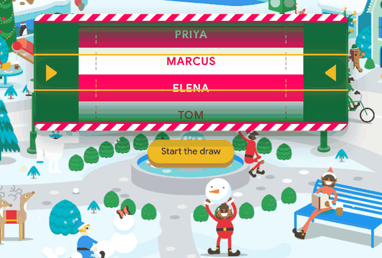
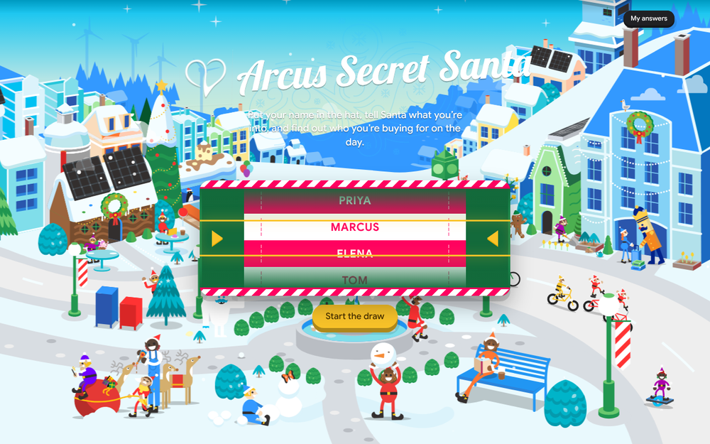
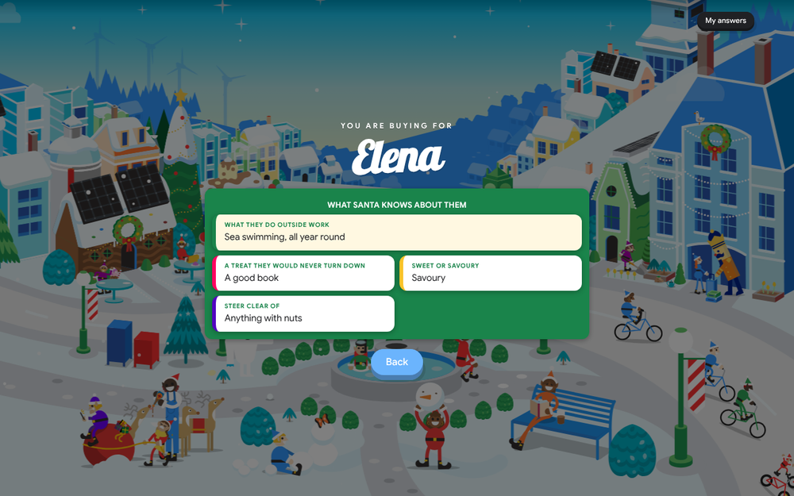
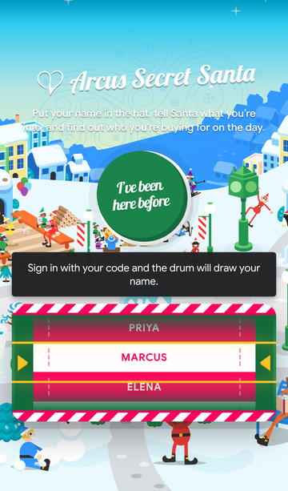

# Arcus Secret Santa

An internal Secret Santa for the team. One snowy village, no scrolling, and a
Santa who asks you what you're into before putting your name in the hat.

On the reveal date (this year, 23 November) the hat closes, the names are
drawn, and everyone comes back to find out who they're buying for.

**Live at [www.arcus-secret-santa.com](https://www.arcus-secret-santa.com)**

## What it looks like

The village, with the raffle drum out of service until the reveal date and the
Build & Bolt elf working on it:


Joining is a conversation. The screen slides in under the site's four-colour
interlude, and Santa breathes, blinks and talks while he asks:






On the day, the drum opens. Start the draw and the tickets fly past the
marker and run down to a stop on your name:







It works on a phone too:



## Running it

Two ways: your own box with a JSON file, or Vercel with Blob storage. The
code is the same either way; only the entry point and the store differ.

### On a box

No dependencies, no build step. Node 18 or newer:

```bash
npm start
```

Then open <http://localhost:3000>.

To run it for the team, put it on any box they can reach and leave it running
(`pm2`, `systemd`, a container — whatever you already use). The pool lives in a
single JSON file, so **back up `data/pool.json`** if you care about it.

### Settings

All optional, all environment variables:

| Variable | Default | What it does |
| --- | --- | --- |
| `PORT` | `3000` | Port to listen on |
| `HOST` | `0.0.0.0` | Interface to bind |
| `REVEAL_DATE` | 1 December of the current year | `YYYY-MM-DD`, midnight server time. Set to `2026-11-23` on Vercel. |
| `DATA_FILE` | `data/pool.json` | Where the pool is stored |
| `ADMIN_TOKEN` | *(unset)* | Enables the admin endpoints below. Leave unset and they stay off. |
| `DEV_TOOLS` | *(unset)* | `1` enables the `?dev` panel and its endpoints. Testing only. |

```bash
PORT=8080 REVEAL_DATE=2026-12-01 ADMIN_TOKEN=some-long-secret npm start
```

### Sharing the link

`public/index.html` carries Open Graph and Twitter card tags, so pasting the
link into Teams, Discord or Slack shows a title, a line of description and a
picture of the village (`public/img/og.png`, 1200×630). Messaging apps cache
these cards; if you change the image, re-paste a slightly different URL (add
`?x=1`) to see the new one.

### On Vercel

The repo deploys to Vercel as static files from `public/` plus one function,
`api/index.js`, which every `/api/*` request is rewritten to (see
`vercel.json`). Vercel's filesystem does not persist, so the pool lives in a
**Vercel Blob** store instead:

1. Create a Blob store and connect it to the project. That sets
   `BLOB_READ_WRITE_TOKEN` on the project; nothing else is needed.
2. Optionally add `REVEAL_DATE` and `ADMIN_TOKEN` as environment variables.
3. Deploy. Pushes to the connected branch deploy automatically.

Without a Blob store the function falls back to a file in `/tmp`, which only
lasts as long as the warm instance does. Fine for a look round, not for the
real thing.

`lib/blobstore.js` talks to the Blob REST API directly, so the app stays
dependency-free. Two rules keep it correct:

* **One document per person** (`secret-santa/people/<id>/…`) plus one for the
  draw (`secret-santa/draw/…`), so two people joining or editing at the same
  moment write different files and cannot overwrite each other.
* **Blobs are never overwritten.** Every save writes a new version to a new
  URL and then deletes the old one. Vercel's Blob CDN caches a URL for at
  least a minute even when asked not to, so overwriting in place could serve
  last minute's content; a brand-new URL cannot be stale. The (uncached) list
  endpoint says which version is current.

Each request lists the prefix and fetches the current documents in parallel: a
few hundred milliseconds for a team-sized pool. Pools from the two earlier
layouts are converted on first read.

Vercel runs on UTC, so `REVEAL_DATE` (and the 1 December default) opens the
drum at midnight UTC.

### Cache busting

The stylesheet and script links in `public/index.html` carry a `?v=N` query.
Browsers cache those files for an hour, so **bump the number when you change
CSS or JS** and everyone picks the new version up on their next load.

## How it works

### Joining

"Join the pool" opens a chat with Santa. He asks for a name, then works through
a short list of questions about hobbies, interests and what they'd never turn
down, finishing with an optional hint. The answers are stored with the person
and are what their Secret Santa sees on reveal day.

The questions live in one array at the top of `public/js/chat.js` — add,
reword or remove them there and everything else follows, including the edit
form on the "My answers" screen.

### Remembering people

Joining returns an **code**: six characters, shown on the "You're in"
screen and again under "My answers".

* The browser remembers whoever joined on it, so coming back is automatic.
* On another device, or after clearing the browser, "I've been here before"
  takes a name and code and picks the profile back up.
* Answers and the hint can be changed at any time, before or after the draw.
  Whoever drew that person always sees the latest version.

Behind the scenes each person has a random token that the browser stores. The
reveal endpoint needs the id *and* the token, so knowing a colleague's name
isn't enough to see their match. This is a bit of fun on an internal network,
not a vault.

### The draw

The first request on or after the reveal date closes the hat and draws the
names. Nobody has to press anything.

`lib/draw.js` uses **Sattolo's algorithm**, which produces a uniformly random
*cyclic* permutation. That gives three things for free:

1. Everyone gives exactly one gift.
2. Everyone receives exactly one gift — it's a bijection, so no name can come
   up twice.
3. Nobody draws themselves — a cyclic permutation has no fixed points.

The result is one gifting circle: A → B → C → … → A. The draw is then re-checked
against those rules by `validateAssignments` before anything is written to disk,
so a bad draw can't be saved.

`test/draw.test.js` runs thousands of draws at various sizes and asserts all of
the above:

```bash
npm test
```

**On odd numbers:** the app shows whether the headcount is even or odd, because
you asked for it, but it doesn't block an odd pool. A one-to-one matching with
no self-draws exists for *any* number of people from 2 upwards — an even count
is only needed if you want everyone paired off *mutually* (A buys for B and B
buys for A), which this isn't.

### Dev tools

Set `DEV_TOOLS=1` and open the site with `?dev` on the end of the address
(`http://localhost:3000/?dev`). A panel appears bottom-left that can:

* seed the pool with 8 (or 7) made-up people, complete with answers and hints
* lock the drum (reveal date next year), or open it (reveal date yesterday)
  which also runs the draw; redraw; or go back to the real reveal date
* sign in as any seeded person, or forget the current one
* jump to any screen

Press `D` to hide or show the panel. The `/api/dev/*` endpoints behind it need
no token, so **unset `DEV_TOOLS` before the real run**: anyone who can reach
the site could reset the pool otherwise. The preview deployment has it on.

### Backups

`scripts/backup.sh` saves everything in the pool (names, codes, sign-in
tokens, answers, hints and, after the draw, the assignments) to a timestamped
JSON file, via `GET /api/admin/export`:

```bash
ADMIN_TOKEN=your-token ./scripts/backup.sh ~/Desktop
```

`scripts/restore.sh` puts one back, replacing whatever is there now (it takes
a fresh backup of the current pool first). Because the tokens come back too,
nobody is signed out:

```bash
ADMIN_TOKEN=your-token ./scripts/restore.sh backups/pool-20261113-124500.json
```

Run a backup now and then, and certainly on the reveal date. The files let
whoever holds them sign in as anyone in them, so keep them private;
`backups/` in the repo is git-ignored.

### Admin

Only if `ADMIN_TOKEN` is set. Useful if you want to draw early or start over.

```bash
curl -s https://www.arcus-secret-santa.com/api/admin/overview -H "x-admin-token: $ADMIN_TOKEN"
```

```bash
curl -s -X POST https://www.arcus-secret-santa.com/api/admin/draw -H "x-admin-token: $ADMIN_TOKEN"
```

```bash
curl -s -X POST https://www.arcus-secret-santa.com/api/admin/reset -H "x-admin-token: $ADMIN_TOKEN" -H 'content-type: application/json' -d '{"emptyPool":false}'
```

Take one person out (by name, or `{"id": "..."}`); refused once the names are
drawn, so reset first if you really mean it:

```bash
curl -s -X POST https://www.arcus-secret-santa.com/api/admin/remove -H "x-admin-token: $ADMIN_TOKEN" -H 'content-type: application/json' -d '{"name":"Wayne"}'
```

`reset` clears the draw and lets people join again. Pass `{"emptyPool": true}`
to also delete everyone.

### The drum

Nobody needs to know the headcount, so the names are shown as a raffle drum
on the home page instead of a list: a reel of red and white tickets that flies
up past a gold marker. Before the reveal date it sits out of service under a
hazard banner with the Build & Bolt elf working on it. From the reveal date,
anyone signed in can start the draw: the reel runs for a few seconds and stops
on the name the server dealt them, then "What Santa knows about..." opens
their answers and hint.

## Layout

```
server.js            zero-dependency HTTP server (static files + the API)
api/index.js         the same API as a Vercel function
vercel.json          Vercel routing: public/ as static, /api/* to the function
lib/api.js           the JSON API as a plain (req, res) handler
lib/draw.js          Sattolo's algorithm + validation
lib/store.js         the pool in a JSON file, written atomically
lib/blobstore.js     the pool in Vercel Blob, same interface
test/draw.test.js    the draw's guarantees, under node --test
test/blobstore.test.js  the Blob layout, against test/fake-blob.js
public/
  index.html         the one page
  css/village.css    the village scene
  css/app.css        shell, transitions, Santa, reel, UI
  css/fonts.css      Lobster, Google Sans, Roboto
  js/weather.js      falling snow and drifting clouds
  js/beard.js        Santa's beard, as a cloth simulation
  js/santa.js        Santa: blinking, breathing, talking
  js/drum.js         the raffle drum reel
  js/chat.js         the questions, and the conversation engine
  js/devtools.js     the ?dev panel
  js/app.js          screens, transitions, and the API client
  vendor/            lottie_light, for the Build & Bolt elf
  img/ fonts/        artwork and fonts
```

### The API

| | |
| --- | --- |
| `GET /api/state` | headcount, reveal date, whether the names are drawn |
| `POST /api/join` | `{name, hint, answers}` → the new person, with token and code |
| `POST /api/signin` | `{name, code}` → that person, with their token |
| `GET /api/me` | `?id=&token=` → the saved profile |
| `POST /api/me` | `{id, token, name?, hint?, answers?}` → the updated profile |
| `POST /api/leave` | `{id, token}` — only while the hat is open |
| `GET /api/match` | `?id=&token=` → who they're buying for. `423` before the reveal date. |

## Where the look comes from

Everything visual is taken from [Google Santa Tracker][st], which is open
source under Apache 2.0. Nothing here is generated artwork.

* **The village** — the `modvil-village` scene. The four parallax layers, the
  skiing elves, the bike pack, the elf in the deckchair, the glitching elf, the
  peekaboo tree, the fountain and the snowman are the site's own SVGs, with its
  own positions and keyframes. The scene is laid out at its native 1920×1050
  and scaled to cover the window.
* **The snow and clouds** — a port of the site's `santa-weather` element,
  including its three cloud SVGs.
* **Santa** — the `santaselfie` scene, at a fraction of the size. His beard is
  that scene's cloth simulation: the same grid, pinning, hair shape and physics,
  settled under gravity and drawn once. He breathes, blinks and moves his mouth
  as he does there.
* **The page transition** — the site's `santa-interlude`: four coloured layers
  sweep up over the screen in sequence, then carry on up and off, with the new
  screen rising in from the bottom.
* **The elf on the drum** — the Build & Bolt card animation from the
  toymaking floor, played with lottie-web (as the site plays it).
* **The buttons, dialogs, cards and notices** — the site's `#play` button,
  `.uibutton`, `santa-overlay`, `santa-card` and `santa-notice`.
* **The fonts** — Lobster, Google Sans and Roboto, the same three the site
  loads, self-hosted in `public/fonts/` so the app needs no network.

Deliberately left out, as asked: Google branding, all sound, the countdown
clock, the family guide, the rest of the village modules, and Santa Selfie's
customisation tools.

Source files that were ported rather than copied carry a comment saying which
part of the site they came from.

[st]: https://santatracker.google.com/
